<div align="center">

# 📅 ContentGrid
### Enterprise Social Content Calendar & Algorithmic Engagement Planner

**Transform Social Chaos into Data-Driven Marketing Strategy**

[](https://github.com/serviceprovidermanchester/SPM-ContentGrid-Social-Content-Calendar-Algorithmic-Engagement-Planner/actions)
[](LICENSE)
[](https://nodejs.org/)
[](package.json)
[](database/)
[](CONTRIBUTING.md)
[](https://spmanchester.com/)

<p align="center">
  <a href="#-project-overview">Overview</a> •
  <a href="#-why-contentgrid">Why ContentGrid</a> •
  <a href="#-key-features">Key Features</a> •
  <a href="#-the-algorithmic-engine">The Engine</a> •
  <a href="#-system-architecture">Architecture</a> •
  <a href="#-quick-start">Quick Start</a> •
  <a href="#-screenshots">Screenshots</a> •
  <a href="#-api-reference">API</a> •
  <a href="#-about-spmanchester-private-limited">About SPManchester</a>
</p>

---

**Built with ❤️ by [SPManchester Private Limited](https://spmanchester.com/)**  
*Part of the SPManchester Digital Product & Ads Management Portfolio*

</div>

---

## 📌 Project Overview

Most marketing teams and digital agencies post on vibes: content is published whenever someone has bandwidth, in whatever format happens to be convenient, without concrete visibility into what genuinely drives high-value customer actions.

**ContentGrid** resolves this by replacing intuition with an **auditable, deterministic engagement engine**. It calculates interaction-intent weighted scores for every piece of content, rolls performance up across creative formats and weekday/daypart slots, and continuously audits your forward schedule against custom publishing cadence and mix targets.

Engineered with a **zero-external-runtime-dependency** philosophy, ContentGrid delivers high throughput, rock-solid stability, and multi-tenant security out of the box using pure Node.js 22 built-ins.

---

## 💡 Why ContentGrid?

| The Traditional Way | The ContentGrid Way |
|---|---|
| **Vanity Metrics:** All likes and impressions treated equally. | **Intent-Weighted Scoring:** Prioritizes high-intent actions (comments ×3, shares ×4, saves ×2). |
| **Guesswork Scheduling:** Random posting times without historical backing. | **Slot Matrix Analytics:** Maps performance across 28 weekday × daypart combinations. |
| **Silent Calendar Gaps:** Unplanned days slip by unnoticed. | **Automated Gap Auditing:** Visualizes exact dates with missing content coverage. |
| **Format Drift:** Over-relying on easy formats rather than strategic targets. | **Cadence & Mix Deviations:** Real-time variance tracking against brand targets. |
| **Heavy Dependency Bloat:** Fragile npm dependency trees and security vulnerabilities. | **Zero Dependencies:** Pure `node:http`, `node:sqlite`, and `node:crypto`. |

---

## ✨ Key Features

- 🎯 **Algorithmic Engagement Scoring:** Mathematically sound, deterministic post-scoring engine factoring in reach and weighted engagement signals.
- 📊 **Multi-Dimensional Roll-Ups:** Aggregates performance by format (`Reel`, `Carousel`, `Image`, `Video`) and time slots (`weekday` × `morning/midday/afternoon/evening`).
- 🗓️ **Forward Calendar Auditing:** Evaluates forward schedule coverage percentage, weekly post velocity, and flags schedule gap days.
- ⚡ **Zero Runtime Dependencies:** Zero external npm packages required. Powered entirely by Node.js 22 native modules.
- 🔒 **Multi-Brand Tenant Isolation:** Secure database-level scoping ensuring tenant data privacy across brand workspaces.
- 🖥️ **Lightweight Native SPA:** Clean, responsive, hash-routed single-page dashboard built with modern vanilla JavaScript and CSS.
- 🧪 **100% Deterministic & Verified:** Accompanied by 62 end-to-end tests including 30 hand-calculated expected value cases.
- 🐳 **Production-Ready Containerization:** Includes lightweight Docker and Docker Compose definitions for instant cloud deployment.

---

## ⚙️ The Algorithmic Engine

The deterministic marketing engine (`backend/src/marketing/engine.js`) operates offline with zero API key dependencies. Every calculation is reproducible and auditable.

### 1. Weighted Engagement Formula

Rather than treating a passive like the same as a viral share, ContentGrid weights interactions by engagement depth:

$$\text{Weighted Interactions} = \text{likes} + (3 \times \text{comments}) + (4 \times \text{shares}) + (2 \times \text{saves})$$

$$\text{Engagement Score} = \frac{\text{Weighted Interactions}}{\text{reach}} \times 100$$

> **Worked Example:**  
> A post achieving **2,000 Reach**, **100 Likes**, **10 Comments**, **5 Shares**, and **20 Saves**:  
> $$\text{Numerator} = 100 + (3 \times 10) + (4 \times 5) + (2 \times 20) = 100 + 30 + 20 + 40 = 190$$  
> $$\text{Score} = \frac{190}{2000} \times 100 = \mathbf{9.50}$$

### 2. Showcase Dataset (Northern Quarter Hospitality Group)

Included as an offline seed representing a multi-venue Manchester hospitality brand:
- **12 Published Posts:** Verified average score of **7.27**
- **Leading Format:** `Reel` leads at **9.33**
- **Top Performing Slot:** `Wednesday evening` at **11.00**
- **November Calendar Audit:** **85%** target coverage (17 of 20 target posts) with **11 gap days** identified.

---

## 🏗️ System Architecture

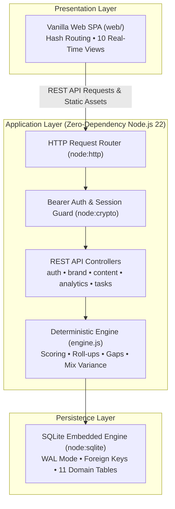

For deeper technical specifications, see [docs/ARCHITECTURE.md](docs/ARCHITECTURE.md).

---

## 🛠️ Tech Stack

- **Runtime & Backend:** [Node.js](https://nodejs.org/) `>= 22.5.0`
  - `node:http`: Low-overhead HTTP server and custom parametric router
  - `node:sqlite`: High-performance embedded SQLite database using WAL mode
  - `node:crypto`: Secure random tokens and cryptographic hashing
- **Frontend:** Vanilla HTML5, modern CSS3, and ES2022 JavaScript
- **Database:** SQLite 3 (11 tables with foreign keys and multi-tenant scoping)
- **Containerization:** Docker & Docker Compose
- **Testing:** Native Node.js test harness with 62 live test cases

---

## 🚀 Quick Start

### Prerequisites

- [Node.js](https://nodejs.org/) version **22.5.0 or higher**
- Git
- (Optional) Docker and Docker Compose

### 1. Clone the Repository

```bash
git clone https://github.com/serviceprovidermanchester/SPM-ContentGrid-Social-Content-Calendar-Algorithmic-Engagement-Planner.git
cd SPM-ContentGrid-Social-Content-Calendar-Algorithmic-Engagement-Planner
```

### 2. Configure Environment

```bash
# Copy example environment configuration
cp .env.example .env
```

### 3. Run the Application

```bash
# Start server (Default port: 4000)
npm start

# Or with live reloading:
npm run dev
```

Open your browser to:
- **Console Web App:** [http://localhost:4000/](http://localhost:4000/)
- **Health Endpoint:** [http://localhost:4000/health](http://localhost:4000/health)

### 4. Default Seed Credentials

| Role | Email | Password | Permissions |
|---|---|---|---|
| **Owner** | `owner@nqhospitality.co.uk` | `Owner2026!` | Full Workspace Access & Settings |
| **Staff** | `team@nqhospitality.co.uk` | `Team2026!` | Content Scheduling & Tasks |

---

## 🐳 Docker Deployment

Run ContentGrid instantly via Docker:

```bash
# Build and run container
docker compose up -d

# Check running status
docker compose ps

# View application logs
docker compose logs -f
```

---

## 🧪 Verification & Testing

ContentGrid includes a comprehensive test suite covering authentication, multi-tenant isolation, algorithmic scoring, roll-up mathematics, and calendar audits:

```bash
# Run all 62 live end-to-end tests
npm test
```

Expected result:
```
62 passed, 0 failed
```

---

## 📸 Screenshots

| 01. Executive Dashboard | 02. Interactive Content Calendar |
|:---:|:---:|
| 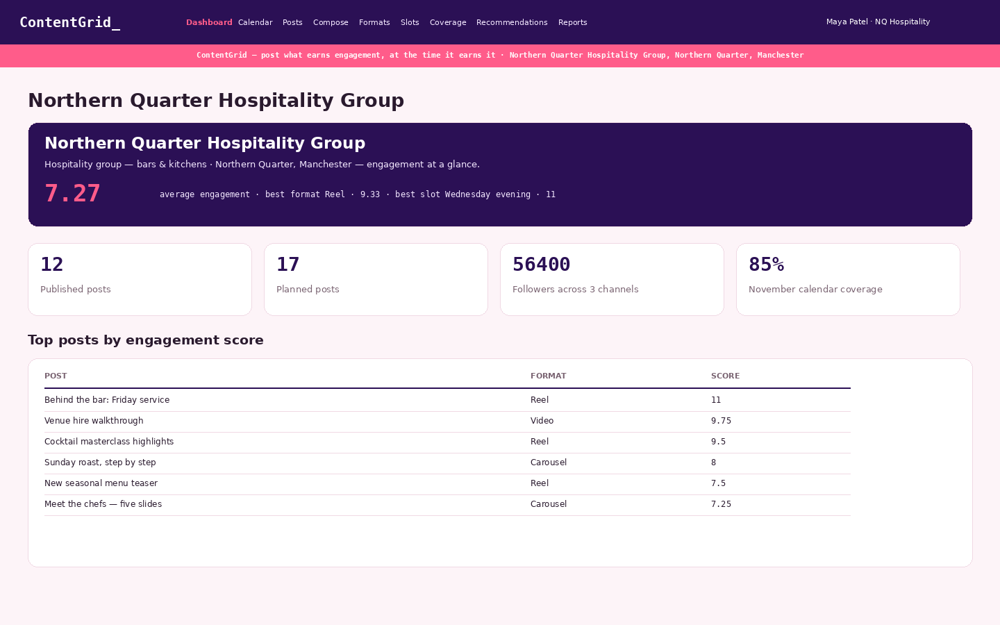 | 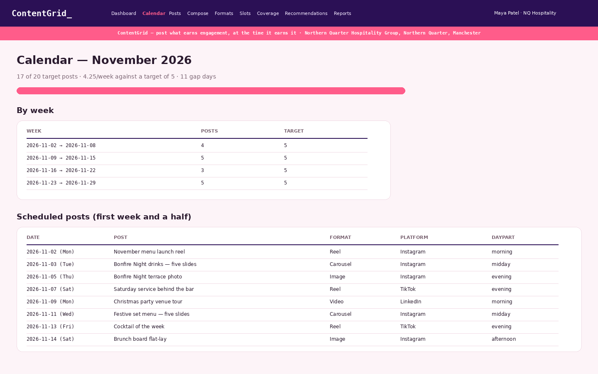 |
| **03. Post Repository** | **04. Post Score Breakdown** |
| 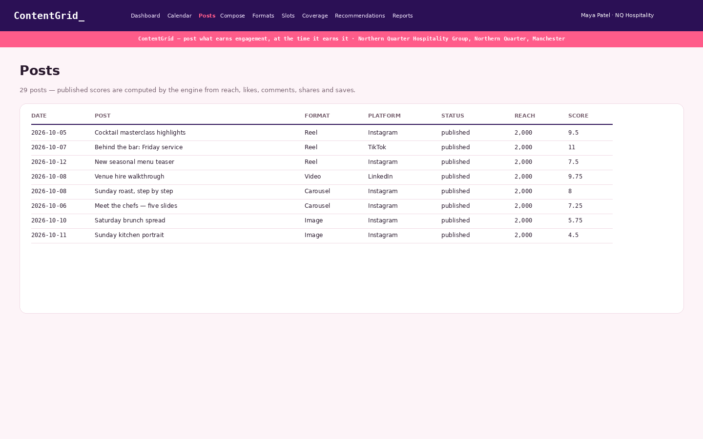 | 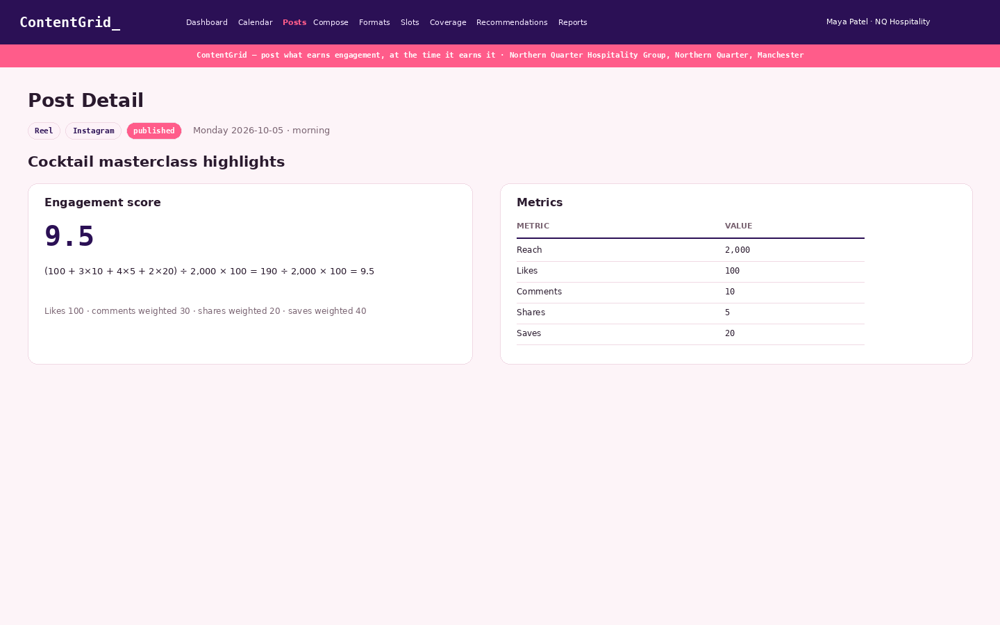 |
| **05. Content Composer** | **06. Format Performance Roll-ups** |
| 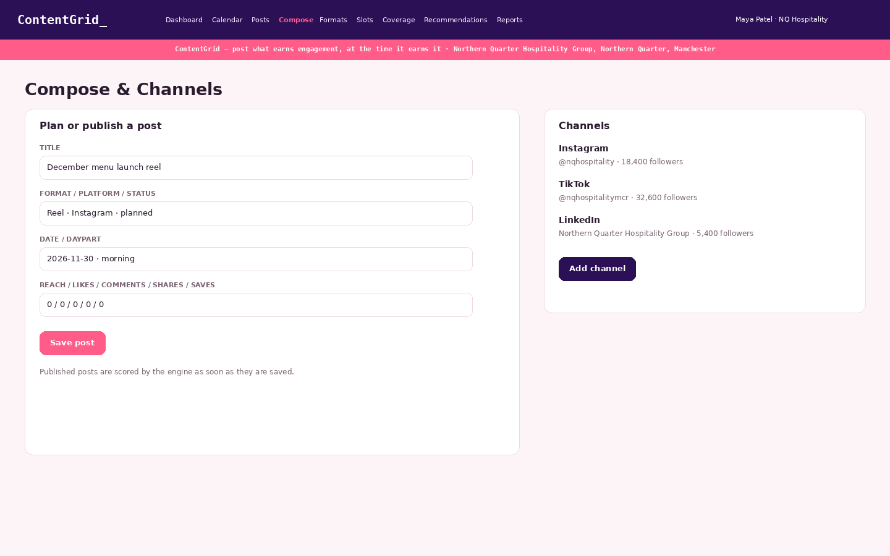 | 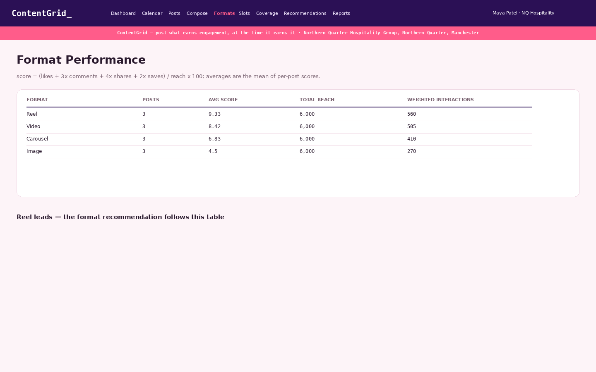 |
| **07. Daypart Slot Analytics** | **08. Coverage & Gap Analysis** |
| 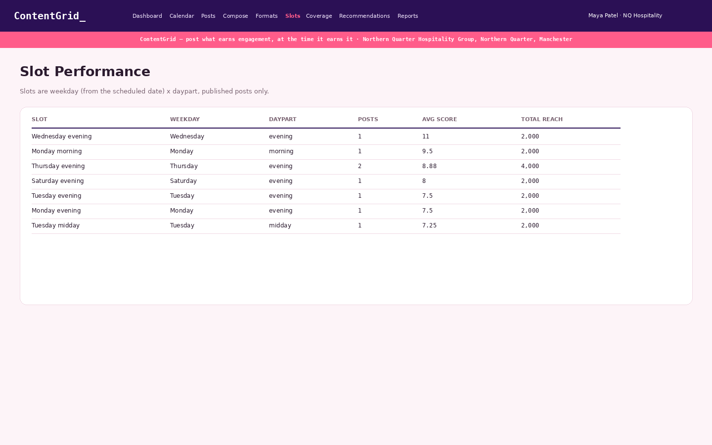 | 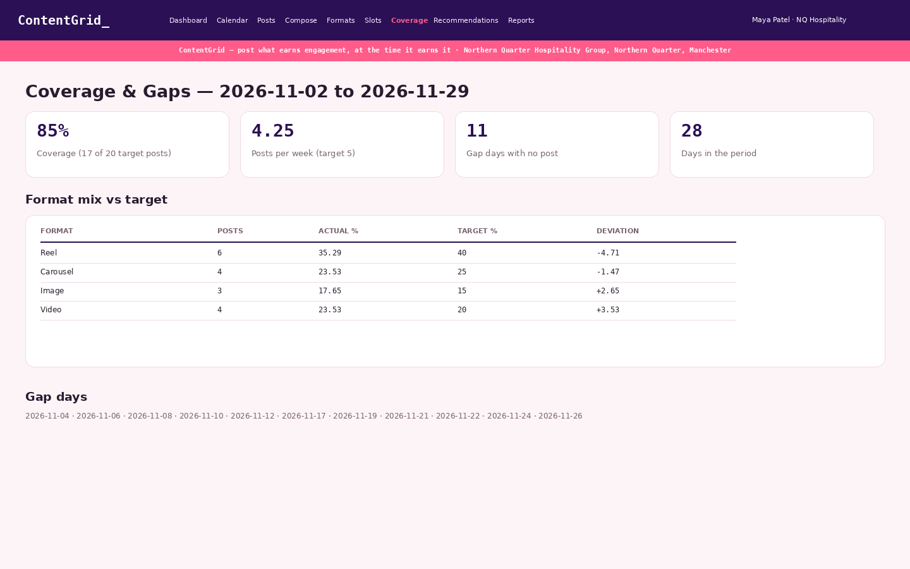 |
| **09. Strategic Recommendations** | **10. Executive Reports & Help** |
| 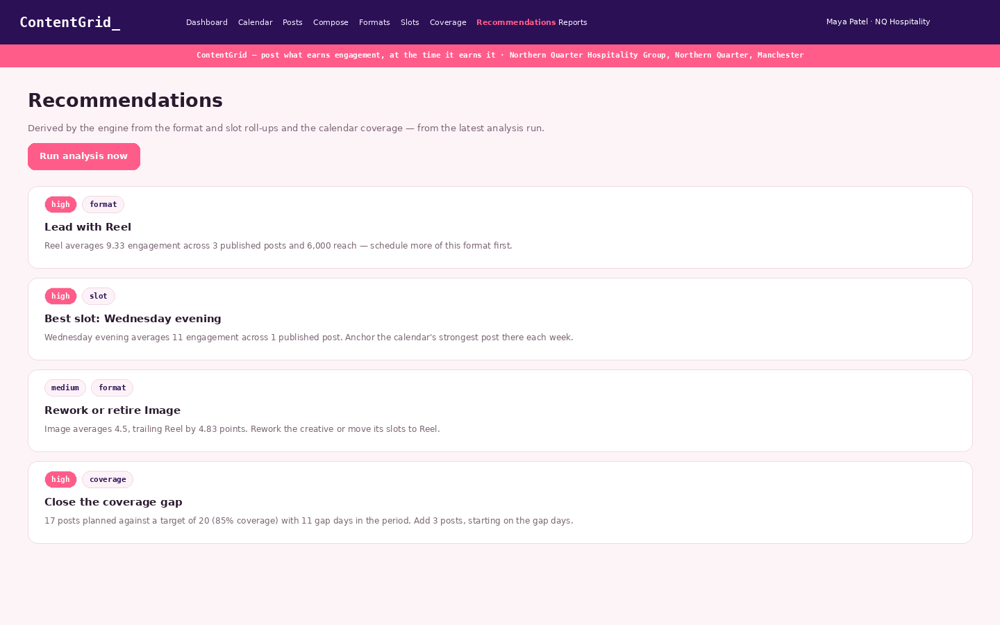 | 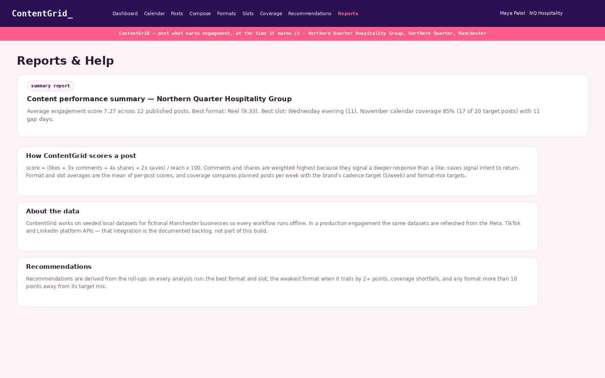 |

---

## 📡 API Reference Overview

The backend exposes **28 RESTful endpoints** under `/api/v1` plus `/health`:

| Resource | Methods | Key Operations |
|---|---|---|
| **Authentication** | `POST`, `GET`, `PUT` | Register, login, logout, get profile, update profile |
| **Brand Settings** | `GET`, `PUT` | Read brand profile, adjust weekly target and format mix |
| **Channels** | `GET`, `POST`, `DELETE` | Manage platform handles and follower metrics |
| **Posts** | `GET`, `POST`, `PUT`, `DELETE` | CRUD post scheduling, publish metrics, score computation |
| **Analytics** | `GET` | Dashboard summary, format roll-ups, slot matrix, coverage |
| **Analysis Runs** | `POST`, `GET` | Execute deterministic audit and retrieve recommendations |
| **Tasks** | `GET`, `POST`, `PATCH` | Editorial workflow and assignment status management |
| **Reports** | `GET`, `POST` | Snapshot creation and executive report retrieval |
| **Notifications** | `GET`, `PATCH` | In-app alerts for gap warnings and audit results |

*For complete request/response schemas, refer to the [API Documentation](docs/API.md).*

---

## 🗺️ Product Roadmap

- [x] Deterministic weighted engagement scoring engine
- [x] Multi-format and weekday × daypart slot roll-ups
- [x] Forward schedule gap detection and mix variance analysis
- [x] Zero-dependency Node.js 22 + SQLite WAL backend
- [x] Multi-tenant workspace isolation with role permissions
- [ ] Direct Meta Graph API integration (Instagram & Facebook Insights)
- [ ] TikTok for Business and LinkedIn Marketing API connectors
- [ ] Exportable CSV / PDF executive reporting
- [ ] Automated campaign webhook triggers & Slack notifications

---

## 🤝 Contributing

We welcome community contributions, bug reports, and pull requests! Please read our [Contributing Guidelines](CONTRIBUTING.md) and [Code of Conduct](CODE_OF_CONDUCT.md) before submitting code.

---

## 🛡️ Security

For vulnerability disclosures, please review our [Security Policy](SECURITY.md) or contact us directly at [info@spmanchester.com](mailto:info@spmanchester.com).

---

## 📄 License

This project is licensed under the **MIT License** — see the [LICENSE](LICENSE) file for details.  
Copyright &copy; 2026 **SPManchester Private Limited**.

---

## 🏢 About SPManchester Private Limited

**[SPManchester Private Limited](https://spmanchester.com/)** is a premium technology consulting, software architecture, and digital engineering company. We build high-throughput enterprise applications, bespoke software solutions, and automated marketing architectures.

### Author & Leadership
- **Lead Architect:** **Sayed Mudassar Akbar**
- **Organization:** **SPManchester Private Limited**
- **Website:** [https://spmanchester.com](https://spmanchester.com)
- **Email:** [info@spmanchester.com](mailto:info@spmanchester.com)

### Looking for Custom Software or Enterprise Marketing Systems?
Need customized integrations with Meta, TikTok, or LinkedIn, or enterprise-grade scaling for your agency?  
👉 **[Contact our Engineering Team](https://spmanchester.com/)** or email **[info@spmanchester.com](mailto:info@spmanchester.com)**.

<div align="center">
<sub>ContentGrid is designed and maintained by SPManchester Private Limited &middot; All rights reserved.</sub>
</div>
