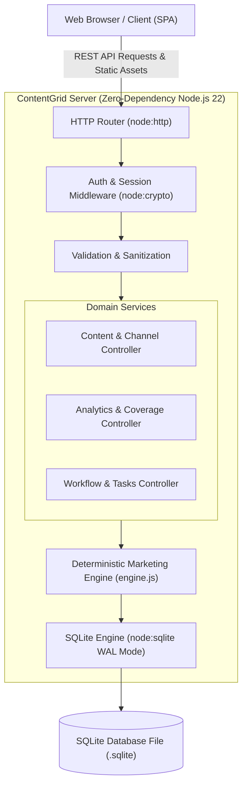

# ContentGrid Architecture & Technical Design

**Author:** Sayed Mudassar Akbar  
**Organization:** [SPManchester Private Limited](https://spmanchester.com/)  
**Contact:** [info@spmanchester.com](mailto:info@spmanchester.com)  

---

## 1. Architectural Philosophy

ContentGrid is engineered as an **enterprise-grade, zero-external-dependency** social content calendar and algorithmic engagement engine.

Traditional marketing suites introduce massive npm dependency trees, complex build pipelines, and external API rate limit risks. ContentGrid takes the opposite approach:
- **Zero Runtime Dependencies:** Built strictly with Node.js 22 built-in modules (`node:http`, `node:sqlite`, `node:crypto`).
- **Deterministic Math:** Every calculation—from post scoring to multi-week calendar gap audits—is 100% deterministic, transparent, and verified with hand-calculated expected values.
- **Strict Brand Isolation:** Multi-tenant workspace isolation at the database layer where every domain record is keyed to `brand_id`.
- **Lightweight Vanilla Front-End:** Native HTML5/CSS3/JavaScript SPA without build steps, webpack, or bloated client bundles.

---

## 2. High-Level System Architecture

---

## 3. The Marketing Engine (`backend/src/marketing/engine.js`)

The engine provides offline, deterministic algorithmic scoring and auditing:

### 3.1 Weighted Engagement Score
Rather than treating all interactions equally, ContentGrid applies an interaction-intent weighting formula:

$$\text{Weighted Interactions} = \text{likes} + (3 \times \text{comments}) + (4 \times \text{shares}) + (2 \times \text{saves})$$

$$\text{Engagement Score} = \frac{\text{Weighted Interactions}}{\text{reach}} \times 100$$

- **Likes (1x):** Low-friction engagement signal.
- **Comments (3x):** Active conversational intent and algorithmic amplification.
- **Shares (4x):** Highest viral signal indicating advocacy.
- **Saves (2x):** Long-term bookmarking intent and return-value signal.
- **Zero Division Guard:** If reach is 0 or negative, score resolves to 0.00.

### 3.2 Format Roll-ups
Groups published content by creative format (`Reel`, `Carousel`, `Image`, `Video`) computing:
- Total published posts per format
- Mean engagement score
- Aggregated reach
- Total weighted interactions

### 3.3 Slot Roll-ups (Weekday × Daypart)
Evaluates audience responsiveness across calendar slots:
- Weekdays: Derived directly from ISO scheduled dates (Monday through Sunday)
- Dayparts: `morning`, `midday`, `afternoon`, `evening`
- Identifies peak performing time slots to eliminate guesswork.

### 3.4 Calendar Coverage Analysis
Audits forward scheduled posts against brand cadence targets:
- **Coverage Percentage:** $\frac{\text{Scheduled Posts}}{\text{Target Posts}} \times 100$
- **Posts per Week:** Normalized weekly publishing rate
- **Gap Days:** Exact calendar dates with zero planned or published posts
- **Format Mix Deviation:** Percentage-point variance between actual scheduled format share and brand strategic targets ($\text{Actual } \% - \text{Target } \%$).

---

## 4. Database Architecture (`backend/src/db.js`)

Leveraging Node 22's native `DatabaseSync` from `node:sqlite`:
- **Storage:** Single-file database with WAL (Write-Ahead Logging) mode enabled for high concurrency.
- **Relational Integrity:** `PRAGMA foreign_keys = ON;` enforced on every connection.
- **11 Domain Tables:**
  1. `users`: Owner and staff accounts with hashed credentials and role scopes.
  2. `sessions`: Ephemeral token storage with expiry timestamps.
  3. `brands`: Workspaces with unique slug identifiers.
  4. `brand_settings`: Weekly cadence targets and target format mix ratios.
  5. `channels`: Social media handles and follower tracking.
  6. `posts`: Content records with full performance metrics and calculated scores.
  7. `post_tags`: Taxonomy mapping for thematic campaigns.
  8. `analysis_runs`: Historical snapshots of audit runs.
  9. `recommendations`: Actionable intelligence generated from analysis runs.
  10. `tasks`: Editorial workflow and team assignments.
  11. `reports`: Executive summary archives.

---

## 5. Security & Isolation Model

- **Session Tokens:** 64-byte cryptographic random tokens generated via `node:crypto.randomBytes()`.
- **Password Security:** Salted SHA-256 hashes generated through native crypto primitives.
- **Role Scoping:**
  - `owner`: Full administrative privileges, workspace settings, channel and post deletion.
  - `staff`: Content authoring, status transitions, task completion, and report viewing.
- **Tenant Isolation:** All CRUD operations enforce `WHERE brand_id = ?`. Cross-tenant queries resolve to standard `404 Not Found` to prevent data harvesting.

---

*Architected and maintained by SPManchester Private Limited. For enterprise consulting and custom integrations, contact info@spmanchester.com.*
